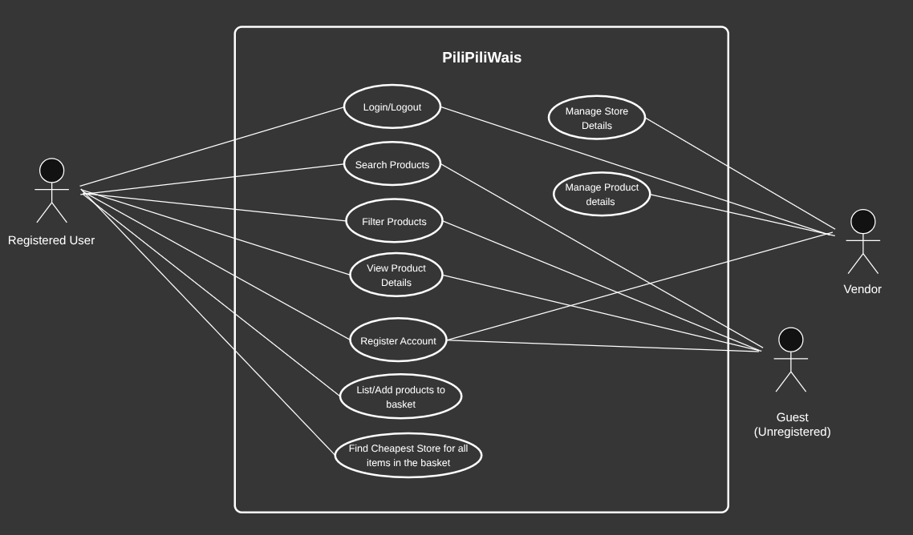

# Product Backlog

## Team Information
- Team name: FTF
- Project title: PiliPiliWais
- Primary user group for the first release: MSU-IIT Undergraduate Students
- Format: User stories with one use case

| Member | GitHub username | Personal CSC181 repository |
| --- | --- | --- |
| Desmond Gold G. Bongcawel | cooky | https://github.com/cooky922/CSC181 |
| Pauline N. Fernan | paulinefernan0901-dotcom | https://github.com/paulinefernan0901-dotcom/CSC181 |
| Vince Ryan P. Dizon | Pintakasi | https://github.com/Pintakasi/CSC181 |
| Sam Gabriel Benedict A. Laguda | sgblaguda | https://github.com/sgblaguda/CSC181 |

## 1. Interview Summary

| Code | Stakeholder role | Date | Method | Interviewer(s) |
| --- | --- | --- | --- | --- |
| S1 | Undergraduate student (2nd year), boarding house resident | 2026-10-23 | In person, structured interview | Bongcawel |
| S2 | Undergraduate student (2nd year), boarding house resident | 2026-10-23 | In person, structured interview | Bongcawel |
| S3 | Undergraduate student (3rd year), boarding house resident | 2026-10-23 | In person, structured interview | Bongcawel |
| S4 | Undergraduate student (2nd year), boarding house resident | 2026-10-23 | In person, structured interview | Bongcawel |
| V1 | Sari-sari store vendor | 2026-10-25 | In person, structured interview (audio recorded) | Dizon, Fernan, Laguda |
| V2 | Sari-sari store vendor | 2026-10-25 | In person, structured interview (audio recorded) | Dizon, Fernan, Laguda |

## 2. From Interview Notes to Needs

| ID | Source | What we heard or saw | Underlying need | Requirement idea | Type |
| --- | --- | --- | --- | --- | --- |
| F1 | S1 | Biggest budgeting challenge: "Walay time magpalit ug mas cheaper item, so I instead go to near shops for convenience." (No time to buy a cheaper item.) | Find cheaper options without spending extra time travelling between stores. | Search results show an item's price at each store on one screen. | F |
| F2 | S1, S2, S3 | Three of four students said they visit multiple stores to get the cheapest price for each item. S4 buys everything in one store for convenience. | Avoid checking store by store by hand. | Search results rank an item's prices from lowest to highest. | F |
| F3 | S1, S2, S3, S4 | All four noticed price differences for the same item across nearby stores: S3 said "significant", S1, S2, and S4 said "slight". | Know where the lowest price is, since differences exist. | Search results label an item's lowest price as "Lowest". | F |
| F4 | S2, S3, S4 | S2: "spontaneous hangouts can also lead to unexpected expenses." S3: "Dali ra mag crave (impulsive)." S4: trying not to get tempted and keeping to the budget set for a period. | Stay within a weekly budget despite unplanned spending. | An item basket (shopping list) shows the difference between its total and the budget the student entered. | F |
| F5 | S1, S2, S3, S4 | Willingness to walk for a cheaper price differs: S3 under 5 minutes, S1 5 to 10 minutes, S2 and S4 more than 10 minutes. | See only the stores that match how far each student is willing to walk. | A student can filter stores by walking time from campus. | F |
| F6 | S1, S2, S3 | Main reason for choosing a store includes product variety: "They almost have everything I need." | Know which items a store does not have before walking there. | Store recommendations list the items of the basket that a store has no price for. | F |
| F7 | V2 | Asked about changing prices themselves, V2 said "Pwede ra kung dili busy." (Fine if not busy.) and said they sometimes focus on selling and also look after an elementary student. | Change a price while spending as little time as possible away from customers. | A vendor can complete an item's price update within 30 seconds, from opening the update form to the saved confirmation. | Q |
| F8 | V1 | Asked about changing prices themselves, V1 said "Kapoy ra oy." (It is tiring.) | Changing a price must not feel slow or difficult during a store day. | Each vendor screen responds to a tap or input within 1 second on a mobile phone. | Q |
| F9 | V1, V2 | Vendors change prices themselves only when they are not busy (V2) and find it tiring (V1). | Students need to tell whether a price is still current, since vendors cannot always update it. | Each price shows the date it was last updated. | F |
| F10 | V1, V2 | V1 said they would take part "kung maka tabang sa mga estudyante" (if it helps students). V2 said they would take part "kung gamit siya" (if it is useful). | See a clear benefit before spending effort. | A vendor can create a store profile with the store's name, landmark, and walking time from campus. | F |
| F11 | V1, V2 | Reaction to price comparison was mixed. V1: "Ahh, bati mana." V2: "Pwede ra." and still fine if their store is the most expensive, "basta makita lang amoang tindahan" (as long as our store is seen), since most customers live nearby. | Prices shown for a store must be the store's own, so vendors are not misrepresented and students can rely on them. | Only a store's own vendor can add, change, or remove that store's prices. | C |
| F12 | V2, S1, S2, S3, S4 | V2's most bought items: coffee, Bear Brand, Milo, shampoo, and "delata" (canned goods). Students' top-5 lists repeat eggs (S1, S2, S4), water gallon (S1, S2, S4), and cooked meal (S2, S3). | A starting item list that matches what is sold and bought. | The first release covers a fixed list of 10 items. | C |

### Assumption log

| ID | Assumption | Risk if wrong (High/Medium/Low) | How we will check it |
| --- | --- | --- | --- |
| A1 | Prices posted by the vendors themselves are credible: vendors post honest prices, and students trust them. Because of this, only vendors can post prices. | High | Compare posted prices with the shelf prices at five stores, and ask students in the walk-through whether they would rely on a price posted by the store itself. |
| A2 | Vendors will keep their prices current, even though V1 called updating "tiring". | High | Time how long a vendor takes to update a price in a prototype, and ask more vendors if that time is acceptable. |
| A3 | Prices of the same item differ enough between nearby stores to matter. Three of four students called the differences "slight". | High | Collect prices of the 10 items from at least five stores near the campus and compute the differences. |
| A4 | Students will keep using the app after they learn which stores are cheapest. | High | During testing, ask students whether they would still open the app after one month of use. |
| A5 | Students use the app on a phone with mobile data while being busy. | Medium | Ask a short question in the walk-through about how and where students would use it. |

## 3. User Stories

| ID | User story | Source finding(s) | Epic | INVEST check |
| --- | --- | --- | --- | --- |
| US-01 | As a student with a limited budget, I want to search for an item and see its price in each store that is approximately less than a kilometer from my location, so that I can find where to buy it without visiting several stores. | F1, F12 | Price search and comparison | Yes |
| US-02 | As a student with a limited budget, I want an item's prices ranked from lowest to highest, so that I can pick the cheapest store at a glance. | F2, F3 | Price search and comparison | Yes |
| US-03 | As a student with a limited budget, I want to filter stores by walking distance from campus, so that I only see stores within the walk I am willing to make. | F5 | Price search and comparison | Yes |
| US-04 | As a student with a limited budget, I want to see the date each price was last updated, so that I can tell whether a price is still reliable. | F9 | Price search and comparison | Yes |
| US-05 | As a student with a limited budget, I want to browse the list of supported items, so that I know what I can look up. | F12 | Price search and comparison | Yes |
| US-06 | As a student with a limited budget, I want to build an item basket (shopping list) with quantities, so that I can plan my purchases before going to a store. | F4, F6 | Item basket and budget | Yes |
| US-07 | As a student with a limited budget, I want to compare my list's total with a budget I set, so that I know if I am going over before I buy. | F4 | Item basket and budget | Yes |
| US-08 | As a student with a limited budget, I want stores ranked by the total cost of my whole list, so that I can pick the store that fits my budget. | F2, F4, F6 | Item basket and budget | Yes |
| US-09 | As a student with a limited budget, I want to see each ranked store's walking time beside its list total, so that I can weigh a lower total against a longer walk. | F5, F2 | Item basket and budget | Yes |
| US-10 | As a sari-sari store vendor, I want to add an item's price to my store, so that students can see what I charge. | F10, F11 | Store and price data | Yes |
| US-11 | As a sari-sari store vendor, I want to update an item's price within 30 seconds, so that updating does not take time away from serving customers. | F7, F8, F11 | Store and price data | Yes |
| US-12 | As a sari-sari store vendor, I want to create a store profile with my store's location, so that students near the campus can find my store. | F10 | Store and price data | Yes |
| US-13 | As a sari-sari store vendor, I want to remove an item I no longer sell, so that students do not see a price I cannot honor. | F9, F11 | Store and price data | Yes |

### Epics and how we split them

| Epic | Split into | How we split it |
| --- | --- | --- |
| Price search and comparison | US-01, US-02, US-03, US-04, US-05 | By workflow step (find an item, compare, narrow the results), and by data type (price, distance, date). |
| Item basket and budget | US-06, US-07, US-08, US-09 | By workflow step (build the list, set a budget, get a store recommendation, weigh distance). Happy path first. |
| Store and price data | US-10, US-11, US-12, US-13 | By workflow step (create the profile, add a price, update it, remove it), and by business rule (only a store's own vendor changes its prices). |

### Stories we rewrote

**1\.** Before: "As a student, I want to compare prices, so that I save money."

> **After:** US-01 (search an item and see its price in each nearby store) and US-02 (rank an item's prices from lowest to highest).

> **Reason:** The original was not Small or Testable. "Compare" and "save money" could mean many things and could not be checked.

**2\.** Before: "As a vendor, I want to manage my store in the app, so that students can find me."

> **After:** US-10 (add a price), US-11 (update a price), US-12 (create a store profile), and US-13 (remove an item).

> **Reason:** The original was too big (not Small), and "manage" was too vague to estimate (not Estimable).

**3\.** Before: "As a student, I want to enter a budget and see my list total against it."

> **After:** US-07 (compare my list's total with a budget I set).

> **Reason:** The original joined two actions with "and", which breaks the one-thing-per-story quality on Week 4, slide 11\.

**4\.** Before: "As a student, I want to submit a price I saw in a store, so that other students see up-to-date prices."

> **After:** removed. Vendors post their own prices in US-10 and US-11 instead.

> **Reason:** The team decided that only vendors post prices, because vendor-posted prices are more credible. Keeping the student story would contradict F11 (Consistent).

**5\.** Before: "As a vendor, I want to update an item's price in a few taps."

> **After:** US-11 (update an item's price within 30 seconds).

> **Reason:** "A few taps" was not Testable or Estimable, and the real need in F7 is the vendor's time away from customers.

## 4. Acceptance Criteria

### US-01: Search an item and see prices

**Acceptance criteria:**

- [ ] Entering the name of one of the 10 supported items lists each store that has a price for it, with the store name and the price in pesos.

- [ ] Searching "Eggs", "eggs", and "EGGS" returns the same results.

- [ ] Results appear within 2.5 seconds when the app holds prices from at least 5 different stores.

- [ ] (unhappy) If the item has no price records, the app shows "No prices yet for \[item\]" and no store rows.

- [ ] (unhappy) If the text does not match a supported item, the app shows "Item not found" and the list of supported items.

**Scenario 1: Normal case**

Given eggs have a price of ₱9 at Store A, ₱10 at Store B, and ₱8 at Store C  
When the student searches "eggs"  
Then the results list Store A with ₱9, Store B with ₱10, and Store C with ₱8

**Scenario 2: No prices recorded**

Given no price records exist for milk  
When the student searches "milk"  
Then the app shows "No prices yet for milk" and lists no stores

### US-02: Prices ranked from lowest to highest

**Acceptance criteria:**

- [ ] Results are sorted from lowest to highest price by default.

- [ ] The lowest price is labelled "Lowest".

- [ ] Each other price shows how many pesos it is above the lowest, for example "+₱1".

- [ ] Stores with the same price are ordered alphabetically by store name.

- [ ] (unhappy) If only one store has a price, the app shows that store with "Only one store has a price" and no comparison difference.

**Scenario 1: Normal case**

Given eggs have a price of ₱9 at Store A, ₱10 at Store B, and ₱8 at Store C  
When the student views the eggs results  
Then the order is Store C ₱8 (Lowest), Store A ₱9 (+₱1), Store B ₱10 (+₱2)

**Scenario 2: Only one price**

Given only Store A has a price for rice  
When the student views the rice results  
Then Store A is shown with "Only one store has a price" and no "Lowest" label or difference

### US-03: Filter stores by distance

**Acceptance criteria:**

- [ ] Each store in the results shows its walking time from campus in minutes and estimated distance in meters.
- [ ] The student can filter by walking distance, and only stores at or under the chosen limit are shown.
- [ ] (unhappy) If no store within the chosen limit has a price for the item, the app shows "No stores within \[distance\] m / km have prices for \[item\]" and offers the next limit.

### US-04: Last-updated date

**Acceptance criteria:**

- [ ] Each price shows the date it was last updated, for example "Nov 11, 2026".
- [ ] A price not updated in the last 14 days is labelled "Outdated".
- [ ] (unhappy) A price record with no date shows "Date unknown" instead of a blank.

### US-05: Browse supported items

**Acceptance criteria:**

- [ ] The home screen lists atleast 10 items by name.
- [ ] Selecting an item opens the same results as searching its name.
- [ ] (unhappy) An item with no price records is still listed and opens "No prices yet for \[item\]".

### US-06: Build an item basket

**Acceptance criteria:**

- [ ] A student can add any of the 10 supported items to the list with a whole-number quantity from 1 to 99\.
- [ ] A student can remove an item, and the list updates within ms.
- [ ] (unhappy) Adding an item already on the list shows "Already on your list" and does not add a second row.
- [ ] (unhappy) A quantity of 0, a negative number, a decimal, or a blank is rejected with "Enter a quantity from 1 to 99".

**Scenario 1: Normal case**

Given the item basket is empty  
When the student adds eggs with quantity 6  
Then the list shows one row, "Eggs x 6"

**Scenario 2: Duplicate item**

Given the item basket contains "Eggs x 6"  
When the student adds eggs again  
Then the app shows "Already on your list" and the list still has one eggs row

### US-07: Compare the list total with a budget

**Acceptance criteria:**

- [ ] A student can enter a budget as a whole number of pesos from ₱1 to ₱10,000.
- [ ] The app shows the list total, using the lowest known price for each item, and the amount remaining or over budget.
- [ ] The total updates when an item or quantity changes.
- [ ] (unhappy) A budget that is blank, zero, negative, or not a number is rejected with "Enter a budget in pesos".
- [ ] (unhappy) If a listed item has no price, the app leaves it out of the total and shows "No price for \[item\], not included in total".

**Scenario 1: Within budget**

Given the list is "Eggs x 6" and the lowest egg price is ₱8  
When the student enters a budget of ₱100  
Then the app shows a total of ₱48 and ₱52 remaining

**Scenario 2: Over budget**

Given the list is "Eggs x 6" and "Rice x 1", the lowest egg price is ₱8, and the lowest rice price is ₱60  
When the student enters a budget of ₱100  
Then the app shows a total of ₱108 and "₱8 over budget"

### US-08: Stores ranked by list total

**Acceptance criteria:**

- [ ] The app ranks the stores that have a price for each item on the list, from lowest to highest total.
- [ ] Each ranked store shows its total and either "Within budget" or "Over by ₱\[amount\]".
- [ ] Stores missing a price for any list item are shown in a separate "Missing items" section with the names of the missing items, and are not ranked.
- [ ] (unhappy) If no store has a price for each list item, the app shows "No single store has every item on your list" and still lists each store with its missing items.

**Scenario 1: Normal case**

Given the list is "Eggs x 6" and "Rice x 1", and the budget is ₱115  
And Store A charges ₱9 for eggs and ₱60 for rice  
And Store B charges ₱10 for eggs and ₱55 for rice  
And Store C charges ₱8 for eggs and has no rice price  
When the student opens the store recommendations  
Then Store A is ranked first with ₱114 (Within budget)  
And Store B is ranked second with ₱115 (Within budget)  
And Store C appears under "Missing items: rice"

**Scenario 2: Stores over budget**

Given the same list and prices as above, and the budget is ₱100  
When the student opens the store recommendations  
Then Store A shows ₱114 (Over by ₱14) and Store B shows ₱115 (Over by ₱15), in that order

### US-09: Walking time beside list total

**Acceptance criteria:**

- [ ] Each ranked store shows its walking time from campus beside its total.
- [ ] The student can sort ranked stores by total or by walking time.
- [ ] (unhappy) A store with no walking time recorded shows "Distance not set" and is placed last when sorted by walking time.

### US-10: Vendor adds an item's price

**Acceptance criteria:**

- [ ] A signed-in vendor can add a price for one of the 10 supported items to their own store.
- [ ] The price must be a number greater than ₱0 and at most ₱9,999.99, with at most 2 decimal places.
- [ ] The app records today's date with the price, and the store appears in that item's results.
- [ ] (unhappy) A price that is blank, zero, negative, or not a number is rejected with "Enter a price greater than ₱0" and nothing is saved.
- [ ] (unhappy) An item already priced at the store is rejected with "Already listed. Update the price instead" and no second row is added.
- [ ] (unhappy) A student account, or a user who is not signed in as a vendor, is blocked from the add-price form with "Only store vendors can post prices".
- [ ] (unhappy) A price that differs by more than 50% from the median price of that item across stores asks "This price is far from other stores. Confirm?" and is saved only if the vendor confirms.

**Scenario 1: Normal case**

Given a vendor is signed in to Store A, eggs are not yet priced at Store A, and the median egg price is ₱9  
When the vendor adds eggs at ₱9.50  
Then the price is saved with today's date and Store A appears in the eggs results at ₱9.50

**Scenario 2: Student tries to post a price**

Given a student is signed in and is not the vendor of any store  
When the student opens the add-price form  
Then the app shows "Only store vendors can post prices" and no form is shown

### US-11: Vendor updates a price within 30 seconds

**Acceptance criteria:**

- [ ] In 5 test runs on a mobile phone, each price update takes 30 seconds or less, measured from opening the update form to the saved confirmation.
- [ ] Each tap or input on the update form gets a visible response within 1 second on a mobile phone.
- [ ] Saving an update changes only that item's price and date, and the results show the new price with today's date.
- [ ] (unhappy) A price that is blank, zero, negative, or not a number is rejected with "Enter a price greater than ₱0", and the old price stays.
- [ ] (unhappy) If the save fails because there is no connection, the app shows "Not saved. Check your connection and try again", and the old price stays.
- [ ] (unhappy) A vendor who tries to edit another store's price is blocked with "You can only edit your own store".

**Scenario 1: Normal case**

Given a vendor's store lists eggs at ₱9  
When the vendor sets eggs to ₱10 and saves  
Then the results show eggs at ₱10 with today's date, and ₱9 is no longer shown as current

**Scenario 2: No connection**

Given a vendor's store lists eggs at ₱9 and the device has no connection  
When the vendor sets eggs to ₱10 and saves  
Then the app shows "Not saved. Check your connection and try again", and eggs remain at ₱9

### US-12: Vendor creates a store profile

**Acceptance criteria:**

- [ ] A vendor can create a profile with a store name (2 to 50 characters), and store’s location..
- [ ] After saving, the store name, landmark, and walking time are shown with each price the store posts.
- [ ] (unhappy) A missing required field is rejected with an error that names the field.
- [ ] (unhappy) A walking time of 0, a negative number, a decimal, or more than 60 is rejected with "Enter a walking time from 1 to 60 minutes".
- [ ] (unhappy) A store with the same name and landmark as an existing store is rejected with "Store already exists".

**Scenario 1: Normal case**

Given a signed-in vendor has no store profile  
When the vendor saves a profile with the name "Store A", the landmark "near the campus gate", and a walking time of 6 minutes  
Then the profile is saved and "Store A, near the campus gate, 6 minutes" is shown with each price the store posts

**Scenario 2: Duplicate store**

Given a store named "Store A" near the campus gate already exists  
When another vendor saves a profile named "Store A" with the landmark "near the campus gate"  
Then the app shows "Store already exists" and no profile is saved

### US-13: Vendor removes an item

**Acceptance criteria:**

- [ ] A vendor can remove an item from their own store after confirming "Remove \[item\] from \[store\]?".
- [ ] After removal, the next search for that item no longer lists the store.
- [ ] (unhappy) If the vendor cancels the confirmation, the item and its price stay.
- [ ] (unhappy) A vendor who tries to remove an item from another store is blocked with "You can only edit your own store".

## 5. Quality Requirements and Constraints (EARS)

| ID | Requirement | EARS pattern | Type | Source | Number agreed with |
| --- | --- | --- | --- | --- | --- |
| NFR-01 | When a student searches for an item, the system shall display the price comparison within 2 seconds | *Event-driven* | *Quality* | F1, F2 | N/A |
| NFR-02 | When a vendor opens an item’s price update form, the system shall let the vendor complete the update, through to the saved confirmation, within 30 seconds.  | Event-driven | *Quality* | F7 | N/A |
| NFR-03 | The system shall list every vendor’s price for an item in the comparison results, including when it is not the lowest price. | Ubiquitous | Quality | F2, F11 | N/A |
| NFR-04 | When a vendor taps or enters input on any vendor screen, the system shall respond within 1 second on a mobile phone.  | Event-driven  | Quality | F8 | N/A |
| NFR-05 | The system shall allow only a store’s own vendor to add, change, or remove that store’s prices.  | Ubiquitous | Quality | F11 | N/A |

## 6. Use Case

### Use-case diagram

### UC-01: Find cheapest store for item basket

| Field | Description |
| --- | --- |
| **Primary actor** | Registered user |
| **Precondition** | User is logged in and has added items to their item basket |
| **Main success scenario** | 1\. Users open their item basket. 
2\. The user presses “Find cheapest store”.
 3\. The system gets the price of each listed item from every store that has it.
 4\. The system shows the stores that have every listed item, ranked by total price for the whole list, with the cheapest first. 
 5\. Users select a store and view its location. |
| **Extensions** | 1a. Item basket is empty: system shows “Your basket is empty” and offers the user to search for the items they need to buy. 
3a. No store carries every item: the system shows “No single store has every item on your list” and lists each store with its missing items, without ranking any of them.  3b. Network fails: system shows “Can’t load prices, check your connection” and keeps the basket as it was. 4a. Two stores have the same total: the system shows both at the same rank. |
| **Postcondition** | Users know which stores have the lowest total for their list and where to find them. |
| **Stories covered** | US-06, US-08, US-09  |

## 7. Story Map

|  | Find an item | Compare prices | Plan an item basket | Stores supply prices |
| --- | --- | --- | --- | --- |
| Release 1 (MVP) | US-01 | US-02 | US-06, US-08,  | US-10, US-11, US-12, US-13 |
| Release 2 |  |  | US-09 |  |
| Later | US-05 | US-03, US-04 | US-07 |  |

## 8. The Ordered Backlog

| Rank | Story | MoSCoW | Size (S/M/L) | Value / effort quadrant | Sprint |
| --- | --- | --- | --- | --- | --- |
| 1 | US-12 — Vendor creates a store profile | Must | S | Quick win | Sprint 1 |
| 2 | US-10 — Vendor adds an item's price | Must | M | Big bets | Sprint 1 |
| 3 | US-01 — Search an item and see prices | Must | M | Big bets | Sprint 1 |
| 4 | US-02 — Prices ranked from lowest to highest | Must | S | Quick wins | Sprint 1 |
| 5 | US-13 — Vendor removes an item | Must | S | Quick Wins | Sprint 1 |
| 6 | US-11 — Vendor updates a price within 30 seconds | Must | M | Big bets | Sprint 1 |
| 7 | US-06 — Build an item basket | Must | M | Big bets | Sprint 2 |
| 8 | US-08 — Stores ranked by list total | Must | M | Big bets | Sprint 2 |
| 9 | US-04 — Last-updated date | Must | S | Quick Wins | Sprint 2 |
| 10 | US-09 — Walking time beside list total | Should | S | Fillers | Sprint 2 |
| 11 | US-07 — Compare the list total with a budget | Should | M | Big bets | Later |
| 12 | US-03 — Filter stores by walking time | Should | S | Fillers | Later |
| 13 | US-05 — Browse supported items | Could | S | Quick wins | Later |

### How we ordered it

Nothing can be searched or compared until vendors have a store and prices in the system, that’s why US-12 and US-10 come first. US-01 and US-02 follow because they deliver the core student value (F1, F2, F3); finding the cheapest store for an item. US-11 is in Sprint 1 because assumption A2 (vendors will keep the prices current) is high-risk, and testing the 30-second update early in the process shows whether the product works at all. The shopping list stories (US-06, US-08, US-09) build on the search results, so they go in Sprint 2\. 

### Capacity check

| Question | Answer |
| --- | --- |
| **How many Must-have stories, and their total size?** | 6 stories: 2 S and 4 M (10 size units if S \= 1 and M \= 2). |
| **Do the Must-haves fit in about 60% of our time for two sprints?** | Yes since we consist of 4 members and have access to AI agents.  |
| **Do the Release 1 stories form one complete path through the core workflow?** | Yes. A vendor creates a profile and posts prices; a student searches and compares, builds a list, and views store totals and walking time. |
| **Are all L-sized Must-have stories split?** | Yes |

## 9. Definition of Done

- [ ] Every acceptance criterion for the story passes, including each unhappy-path criterion and the Given-When-Then scenario.
- [ ] All Must in the category backlog are implemented and passes unit test.
- [ ] The feature is tested on a mobile phone, and any performance numbers in the criteria (1,3 or 30 seconds) are measured
- [ ] Invalid input, unavailable data, and relevant permission or save failures show the specified user-facing feedback and do not leave incorrect data saved.
- [ ] The code is reviewed and approved by at least one other team member through a pull request before merging to the main branch.
- [ ] The change is merged to the main branch with no known open bugs, and the GitHub issue is closed with a link to the pull request.

## 10. Traceability Table

\[One row per Must-have story. See Week 4, slide 30\. You will add test case IDs

in Week 9.\]

| Story | Problem or goal it addresses | Source finding(s) | Test cases (Week 9\) |
| --- | --- | --- | --- |
| US-12 | Help students identify a participating store and where it is located. | F10 | \[Leave blank for now\] |
| US-10	 | Let students see a store's own prices while preventing store misrepresentation. | F10, F11 | \[Leave blank for now\] |
| US-01 | Find cheaper options without travelling between stores. | F12 | \[Leave blank for now\] |
| US-02 | Know where the lowest price is without checking store by store | F2, F3 | \[Leave blank for now\] |
| US-08	 | Help students compare the cost of a complete shopping list across stores. | F2, F4, F6 | \[Leave blank for now\] |
| US-06 | Help students plan quantities and account for unplanned spending. | F4, F6 | \[Leave blank for now\] |

Gaps found: None

## 11. Validation

### Team review

| Problem found | Story or requirement | How we fixed it |
| --- | --- | --- |
| E-Estimable: Needs to clarify how nearby stores are Identified | US-01 | Defined the nearby store. A store is considered nearby if it is approximately less than a kilometer away from the user’s location |
| Dependent on US-10 | US-02 | We addressed this dependency during sprint planning by ensuring that the vendor price-entry functionality (US-10) is implemented alongside US-02 and that the database is seeded with appropriate product and price data. |

### Stakeholder walk-through

\[Show the story map and the top of the backlog to at least one stakeholder you

interviewed. See Week 4, slide 31.\]

| Stakeholder | Date | What they said | What we changed |
| --- | --- | --- | --- |
|  | 2026-10-25 |  | \[Change\] |
|  |  |  |  |

## 12. Open Questions for Sprint 1

1.How will students verify that the prices they see are accurate?

2.How do we ensure that a user registered as a store owner is legitimate and uploads accurate product prices?

3\. How do we find the lowest store to buy the items in the user’s basket if we can’t find a store that has all the items in the basket ?

4\. Should users be notified when a vendor changes a product's price?

 

## 13. Member Contribution Record

| Member | Interviews or analysis | Stories, criteria, or use case | Review or validation |
| --- | --- | --- | --- |
| Desmond Gold C. Bongcawel | Interviewed students S1, S2, S3, and S4 on 10/23/2026 | Worked on section 2, 3, and 4 | Reviewed and validated each section as well as the whole paper |
| Pauline N. Fernan | Interviewed vendors V1 and V2 on 10/25/2026 | Worked on section 5, 6, and 7 | Reviewed and validated each section as well as the whole paper |
| Vince Ryan P. Dizon | Interviewed vendors V1 and V2 on 10/25/2026 | Worked on section 8, 11, 12, and created the use-case diagram  | Reviewed and validated each section as well as the whole paper |
| Sam Gabriel Benedict A. Laguda | Interviewed vendors V1 and V2 on 10/25/2026 | Worked on sections 8, 9, and 10 | Reviewed and validated assigned sections as well as the whole paper. |

## 14. References

* CSC181 Week 3 Lecture slide \- Stakeholders, problem framing, scope, and feasibility  
* CSC181 Week 4 Lecture slide \- Requirements, user stories, use cases, and acceptance criteria

## 15. Team AI Use Declaration

- [X] No generative AI tools were used by any member in preparing this submission.
- [] One or more members used generative AI tools. Details are provided below.

*Not applicable*

## 16. Team Confirmation

We confirm that this document reflects our team's agreed-upon product backlog. All members listed below reviewed the final version, and each member will upload the same Markdown file to their personal CSC181 repository.

| Member | Reviewed final version |
| --- | --- |
| Desmond Gold C. Bongcawel | Yes |
| Pauline N. Fernan | Yes |
| Vince Ryan P. Dizon | Yes |
| Sam Gabriel Benedict A. Laguda | Yes |

## Submission Checklist

- [X] Interviews cover at least two stakeholder groups, with sources coded and no personal information.
- [X] The needs table has at least 8 findings, each labelled F, Q, or C.
- [X] Assumptions are recorded separately from evidence.
- [X] There are 10 to 15 user stories, each with a real role, a "so that", and at least one finding.
- [X] Epics are split, and at least two rewrites are recorded.
- [X] Every story has at least 3 acceptance criteria, including an unhappy path, with no weak words.
- [X] Every Must-have story has at least 2 Given–When–Then scenarios.
- [X] At least 3 quality requirements or constraints use EARS patterns.
- [X] One use case has a diagram, a main success scenario, and at least 2 extensions.
- [X] The story map has a Release 1 line that crosses every journey step.
- [X] Every story has a MoSCoW label and a size, and the backlog is in one order with no ties.
- [X] Must-haves fit in about 60% of capacity. Won't-have stories are kept, not deleted.
- [X] A Definition of Done is included.
- [X] The traceability table covers every Must-have story.
- [ ] The team review and the stakeholder walk-through are recorded.
- [X] Contributions, references, and AI use are declared.
- [X] All members reviewed the same final document.
- [X] Each member saved the file as activities/product-backlog.md, with images in activities/backlog-images/.
- [X] Each member committed and pushed their copy to their personal repository.
- [X] Each member submitted their own GitHub file link through MOLE before November 9, 2026 23:59:59.